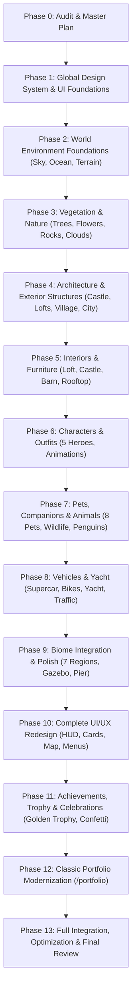

# WORLD REDESIGN MASTER PLAN
## Pastel Kawaii 3D Claymorphism & Miniature Adventure Universe

---

## 1. Executive Summary & Creative Direction

### 1.1 The Creative Vision
Transform Mayur Shetty's interactive 3D portfolio and classic web portfolio into a **Pastel Kawaii 3D Claymorphism + Soft Toy Aesthetic + Miniature Diorama World**.

* **Aesthetic Identity**: Tactile handcrafted clay toy feel, rounded bevels, smooth silhouettes, soft satin/matte surfaces, gentle ambient occlusion and pastel lighting. No harsh low-poly angles, no cold realistic rendering, no cheap plastic shine.
* **Master Palette System**:
  * **Primary Pastel Tokens**:
    * Soft Lavender: `#DCC8F5`
    * Light Lilac: `#EADDFB`
    * Pastel Pink: `#F7CDE2`
    * Baby Blue: `#BBDDF8`
    * Cream White: `#FFF6E9`
    * Peach: `#F5C5A8`
    * Mint Green: `#C4E8CF`
  * **Supporting Pastel Tokens**:
    * Sage Green: `#AFCFAE`
    * Soft Coral: `#F4AFA8`
    * Butter Yellow: `#F7E3A3`
    * Sky Blue: `#A9D8F4`
    * Warm Beige: `#EAD8C6`
  * **Deep Contrast (Text & Accents)**: Warm Cocoa Brown (`#4A3728`) and Deep Plum Violet (`#382442`).
* **Source of Truth Balancing**:
  * **Category A (Existing Portfolio & Codebase)**: Dictates **WHAT** exists — actual layout, locations, journey path, enterable interiors, real resume facts, vehicle types, characters, and physics.
  * **Category B (New References `new look1`–`8`)**: Dictates **HOW** it looks — claymorphic building bevels, adorable chubbiness, pastel grass/water/sky, cute typography, rounded pills, and cozy atmosphere.

---

## 2. Creative World Naming Proposals

To replace the plain "Mayur's World" with a captivating, adorable brand identity:

1. **Mayur's Wonderworld** *(Recommended)*: Evokes a magical, handcrafted miniature wonderland; friendly, playful, and universally inviting.
2. **Mayur's Little Universe (or Mayur's Tiny Universe)**: Directly reflects the miniature diorama toy aesthetic.
3. **Mayurverse**: Sleek, modern, tech-forward yet playful.
4. **Wonderland of Mayur**: Whimsical storybook charm.

*Recommendation*: **Mayur's Wonderworld** as the primary title, with "A Miniature Adventure by Mayur Shetty" as the subtitle.

---

## 3. Complete Codebase Architecture Audit

### 3.1 Technology Stack
* **Framework**: TanStack Start (v1.168.60) + TanStack Router (v1.170.41) on Vite 8 & Nitro.
* **3D Engine**: Three.js (v0.186.1) + React Three Fiber (`@react-three/fiber` v9) + `@react-three/drei` v10.
* **Styling & UI**: Tailwind CSS v4 (`@tailwindcss/vite`), Radix UI primitives, Lucide React icons.
* **State Management**: Low-frequency UI state in Zustand (`src/game/store.ts`); high-frequency per-frame state in mutable module singletons (`player` in `store.ts`, `input.ts`) to avoid React re-render thrashing.
* **Math & World**: Pure decoupled math in `src/game/` (collision hashing, heightfields, layout, procedural furniture, vehicle physics, audio synth).
* **Testing**: Vitest v4 with 16 test suites (90 tests passing).

### 3.2 Architectural Separation of Concerns
1. `src/data/portfolio.ts`: The single source of truth for all resume data (Education, Experience, Projects, Skills, Achievements, Certifications, Contact).
2. `src/game/`: Pure headless simulation, geometry builders, and data tables:
   * `world.ts`: Heightfield generation, road curve, river curve, distance fields.
   * `regions.ts`: 7 ordered journey regions.
   * `stops.ts`: 7 key chapter hotspots with triggers.
   * `layout.ts`: City towers, village placement, farm plots, ring road loops, lamps.
   * `characters.ts`: Explorers (5 heroes), companions (8 pets), super powers, outfits.
   * `vehicles.ts`: 7 drivable rides + 1 luxury yacht with engine synthesizers and handling models.
   * `buildings.ts` & `interiors.ts`: Doors, rooms, floors, stairs, furniture, spots (sit, lie, lift).
   * `scatter.ts`: Instanced model distribution, collision hash grids, dynamic moving bodies.
   * `chill.ts`: Rooftop loungers, seaside benches, swing with sipping animation.
   * `trophy.ts`: Mountain peak celebration, lift physics, confetti timing.
3. `src/components/world/`: React Three Fiber rendering components:
   * `WorldScene.tsx`: Scene orchestrator, lights, camera rig.
   * `Environment.tsx`: SkyDome shader, Terrain with vertex coloring, Ocean, River, Waterfalls.
   * `City.tsx`, `Village.tsx`, `Farm.tsx`, `Forest.tsx`, `Seaside.tsx`, `Landmarks.tsx`: Biome renderers.
   * `Interior.tsx`: Walk-in room shells, furniture placement, always-mounted 4-light pool.
   * `Hero.tsx`, `Player.tsx`, `Companion.tsx`, `Pets.tsx`, `Wildlife.tsx`, `Agents.tsx`: Animated entities.
   * `Vehicles.tsx`, `supercarModel.ts`, `yachtModel.ts`, `boatGeometry.ts`: Rides.
   * `materials.ts`: Global foliage wind vertex shaders, ocean wave shaders, facade generators.
4. `src/components/game/`: DOM UI overlays:
   * `OpeningScreen.tsx`, `CharacterPicker.tsx`, `HeroPreview.tsx`, `PetPreview.tsx`, `VehiclePreview.tsx`.
   * `Hud.tsx`: Navigation badge, distance tracker, active power pill, interaction prompts.
   * `StoryCard.tsx`: Chapter progress and resume story reader.
   * `WorldMap.tsx`: Top-down interactive teleport map.
   * `MobileControls.tsx`: Virtual joystick and action touch buttons.
   * `TitleSign.tsx`: Animated entrance billboard.
5. `src/routes/portfolio.tsx`: Accessible, SSR-friendly Classic Portfolio view matching the same design system.

---

## 4. Complete World Inventory

### 4.1 Locations & Biomes
| # | Region ID | Region Name | Landmark Hotspot | Core Theme | Reference Snapshot |
|---|-----------|-------------|------------------|------------|-------------------|
| 1 | `meadow` | Meet-Cute Meadow | Hey Stranger Gate (x: -132, z: 54) | Flower fields, gate arch, welcome path | `new look1`, `Screenshot 123251` |
| 2 | `forest` | Sweet Nothings Woods | Big Brain Castle (x: -98, z: -24) | Academy, stone keep, library interior, falls, bridge | `Screenshot 123401` |
| 3 | `fields` | Butterfly Crush Fields | Crush-Worthy Creations Mill (x: -6, z: 16) | Farm, windmill, barn, wheat & corn plots, tractor | `Screenshot 123516` |
| 4 | `village` | Cosy Crush Village | Forbidden Tricks Square (x: 46, z: -14) | Timber cottages, inn, bell tower, cobbled plaza, fountain | `Screenshot 123552` |
| 5 | `city` | Downtown Drama | Towers of Situationships (x: 104, z: 22) | Rounded skyscrapers, hospital, clinic, ring road, traffic | `new look7` (quad 4), `Screenshot 123716` |
| 6 | `cliffs` | Cliffhanger Heights | Main Character Peak (x: 134, z: -34) | Mountain spiral path, golden trophy pedestal, pines | `new look5` (quad 4), `new look7` (quad 1) |
| 7 | `harbor` | Sunset Rizz Harbor | Slide-Into-My-DMs Lighthouse (x: 152, z: 28) | Left-On-Seen Lofts, beach boardwalk, yacht pier, icebergs | `new look1`, `new look2`, `new look6` |

### 4.2 Characters & Outfits
* **Shetty (Mayur)**: The Heartbreak Architect — Long coat, swept hair, moustache, glasses, chain, rocket jetpack. Power: *Sky Flight*.
* **Blaze Romeo (Kai)**: Radium-line hoodie, fire gauntlets, sporty sneakers. Power: *Flash Rush*.
* **Sora Cloud (Sora)**: Minimalist open jacket, floating energy orbs. Power: *Blink* (teleport).
* **Rosé Ruin (Hana)**: Kimono-styled long coat, bun, sakura petal wings. Power: *Shadow Veil* (invisibility).
* **Jinx Casanova (Ren)**: Storm hoodie, neon headphones, baggy jeans. Power: *Moon Leap*.

### 4.3 Pets & Companions
* **Byte Me**: Floating robot cat with glitch spin and cooldown perk.
* **Bao Bae (Panda)**: Straw hat, bamboo snack animation, power duration perk.
* **Pip Cold-Heart (Penguin)**: Aviator scarf & goggles, belly slide, swim boost perk.
* **Mochi Heartthief (Bunny)**: Flower crown, ribbon bow, bounce jump perk.
* **Ember Red Flag (Dragon)**: Flapping wings, flame puff, soft wing glide perk.
* **Luna Femme Fatale (Cat)**: Golden crown, bell collar, high climb perk.
* **Biscuit Big Simp (Puppy)**: Hero cape, bandana, walk speed zoomies perk.
* **Rusty Situationship (Fox)**: Wizard hat, emerald scarf, ride nitro perk.

### 4.4 Vehicles & Transportation
* **Velvet Venom**: Two-tone curved hypercar / supercar (Yellow/Black in references).
* **Wild Thing Rally**: Rugged off-road rally car with roof rack.
* **Coastline Cruiser**: Open-top convertible coupe.
* **Apex Phantom**: Sleek luxury sport sedan.
* **Monarch Overland**: High-clearance SUV.
* **Dune Buster**: Open tubular chassis jeep.
* **Thunderbolt**: High-speed racing superbike.
* **Dust Devil**: Scrambler dirt bike.
* **The Grand Romance (Yacht)**: Two-deck luxury yacht with sundeck, cabin, navigation bridge, and life preservers.
* **City Traffic**: Compact cars, mini delivery vans, ambulance with flashing light.
* **Farm Machinery**: Green & yellow vintage crop tractor.

### 4.5 Wildlife & Environmental Creatures
* **Wildlife**: Elephants, zebras, deer/stags, farm dairy cows, sheep.
* **Ocean Life**: Iceberg penguins, breaching humpback whales, jumping dolphins, reef fish schools, harmless reef sharks, bobbing buoys.
* **Birds**: Animated bluebirds perched on entrance signage, seagulls over the marina.

### 4.6 Buildings & Enterable Interiors
* **Left-On-Seen Lofts (Lighthouse Residence)**: Kitchen with rounded fridge & barstools, living room with retro CRT TV & sofa, wooden staircase with fairy lights, bedroom, bathroom with sliding curtain, rooftop terrace with loungers, white umbrella, and string lights.
* **Big Brain Castle**: Academic grand hall, multi-level library bookshelves, lecture tables, education board.
* **Crush-Worthy Creations Mill**: Workshop interior with project exhibition boards and gear mechanisms.
* **Situationship HQ (Skyscraper)**: Corporate glass atrium with internship experience exhibition boards.
* **Village Cottages & The Flirty Fox Inn**: Cozy timber rooms with fireplaces, rugs, and dining sets.
* **Hay There Barn**: Farm storage, hay bales, and loft spaces.
* **Seaside Gazebo**: Round pavilion with warm glowing paper lanterns overlooking sunset.

---

## 5. Visual Transformation Strategy (The Claymorphism Overhaul)

### 5.1 Geometry & Modeling
* **Curvature & Bevels**: Replace hard sharp polygon corners with beveled edges and subdivided silhouettes.
* **Chunky Proportions**: Roofs get soft overhang scallops (like the yellow awning on Left-On-Seen Lofts); windows get rounded terracotta frames; planters get puffy foliage clusters.
* **Puffy Vegetation**: Trees transformed into tiered rounded clouds of foliage; rocks modeled as smooth beach pebbles and rounded boulders; mushrooms with plump pastel caps and white dots.

### 5.2 Materials & Lighting
* **Tactile Clay Surfaces**: High roughness (0.75–0.92), low metalness (0.0–0.05), soft subsurface scattering simulation via ambient warm fill.
* **Pastel Palette Coordination**:
  * Terrain: Mint green hills (`#C4E8CF`), sage meadows (`#AFCFAE`), butter yellow wheat fields (`#F7E3A3`), peach sand (`#F5C5A8`).
  * Architecture: Cream white walls (`#FFF6E9`), soft terracotta trims (`#F5C5A8`), lilac roofs (`#EADDFB`), baby blue window glass (`#BBDDF8`).
  * Ocean & Water: Dreamy pastel turquoise shallows (`#A9D8F4`), soft lavender-blue deep water (`#DCC8F5`), creamy foam ripples (`#FFF6E9`).
* **Fixed Light Budget**: Preserve the zero-stutter single directional sun + ambient + fixed 4-light interior pool architecture.

### 5.3 Typography & Design System
* **Headings**: **Fredoka** (cute, rounded, legible, playful).
* **Body & Numerical Labels**: **Nunito** (soft, clean, highly readable at all sizes).
* **UI Controls**: Glassmorphism/Claymorphism hybrid pills — frosted pastel backgrounds with subtle inner highlights and rounded drop shadows.

---

## 6. Technical Audit & Optimization Opportunities

### 6.1 Identified Issues & Fixes
1. **Vitest EPERM on Parent Traversal**: Vitest currently looks up to `C:\Users\mayur\package.json`. Configured root option `--root .` ensures standalone sandbox execution.
2. **Typography Font Inconsistencies**: Font definitions in `src/styles.css` currently reference `Yellowtail` and `Lobster Two`. Consolidating to `Fredoka` and `Nunito` eliminates mismatched fonts and external requests.
3. **Color Token Alignment**: Dark forest oklch variables in `:root` (`oklch(0.22 0.045 155)`) will be mapped to the new Master Pastel Design Tokens.
4. **Signage Asset Refresh**: `title-wood.webp` has hardcoded "Mayur's World". Upgrading to the new world identity with dynamic, animated vector elements ensures crisp rendering on all DPIs.
5. **Mobile Viewport Optimization**: Ensure HUD pills and bottom banners scale dynamically with safe-area insets without overlapping touch joystick or action buttons.

---

## 7. Phased Implementation Roadmap

*Note*: Each phase will be implemented, verified with tests and builds, presented with testing results, and paused for your review before proceeding.

---

## 8. Progress Checklist

- [x] **Phase 0: Complete Codebase Audit & Master Plan**
  - [x] Investigate full repo architecture, state, rendering, and test suites.
  - [x] Verify existing 90 automated tests and build pipelines.
  - [x] Analyze all 8 new design reference images and current world snapshots.
  - [x] Formulate master pastel color tokens and typography hierarchy.
  - [x] Produce `WORLD_REDESIGN_MASTER_PLAN.md`.
- [ ] **Phase 1: Global Design System & UI Foundations**
  - [ ] Implement master pastel color system in `styles.css`.
  - [ ] Configure Fredoka + Nunito typography hierarchy.
  - [ ] Redesign `WorldButton`, pill badges, and glassmorphic card primitives.
  - [ ] Transform `LoadingScreen.tsx` with pastel clay theme and decorative vines.
  - [ ] Transform `OpeningScreen.tsx` (Welcome Island flow) with the new world identity.
  - [ ] Run test suites & build verification. Present for inspection.
- [ ] **Phase 2: World Environment Foundations**
  - [ ] SkyDome shader update (dreamy pastel gradient: peach, lilac, baby blue).
  - [ ] Lighting & ambient tuning (soft clay lighting, gentle directional sun).
  - [ ] Ocean and river material shaders (turquoise shallows, pastel swells, cream foam).
  - [ ] Terrain vertex coloring (mint, sage, butter yellow, peach sand).
  - [ ] Run test suites & build verification. Present for inspection.
- [ ] **Phase 3: Vegetation & Environmental Details**
  - [ ] Procedural rounded cloud-like foliage for pine and broad trees.
  - [ ] Soft rounded bushes, stylized flowers, and cute spotted mushrooms.
  - [ ] Smooth clay pebbles and rock formations.
  - [ ] Fluffy diorama clouds.
  - [ ] Run test suites & build verification. Present for inspection.
- [ ] **Phase 4: Architecture & Exterior Structures**
  - [ ] Slide-Into-My-DMs Lighthouse & Left-On-Seen Lofts exterior (yellow awning, terracotta frames, planters).
  - [ ] Big Brain Castle exterior (soft rounded stone towers, pastel roofs).
  - [ ] Village cottages, inn, bell tower, and mill.
  - [ ] City blocks, hospital, and commercial facades with rounded cornices.
  - [ ] Directional road signs and fencing.
  - [ ] Run test suites & build verification. Present for inspection.
- [ ] **Phase 5: Interior Environments**
  - [ ] Left-On-Seen Lofts interior (kitchen, rounded fridge, barstools, CRT TV, wooden stairs with fairy lights).
  - [ ] Rooftop terrace (timber deck, loungers, cocktail table, white parasol, string lights).
  - [ ] Big Brain Castle library & academy interiors.
  - [ ] Workshops and farm barn interiors.
  - [ ] Validate sit/rest spots, elevators, and ladder climbing.
  - [ ] Run test suites & build verification. Present for inspection.
- [ ] **Phase 6: Characters & Outfits**
  - [ ] Restyle Shetty (Mayur), Kai, Sora, Hana, and Ren with cute clay proportions.
  - [ ] Smooth hairstyles, clothing accents, and soft skin materials.
  - [ ] Validate character picker 3D preview and all movement animations.
  - [ ] Run test suites & build verification. Present for inspection.
- [ ] **Phase 7: Pets, Companions & Animals**
  - [ ] Restyle all 8 pets (Byte, Panda, Penguin, Bunny, Dragon, Cat, Puppy, Fox).
  - [ ] Adorable waddles, belly slides, hops, and following mechanics.
  - [ ] Restyle wildlife (elephants, zebras, cows, sheep) and ocean penguins.
  - [ ] Run test suites & build verification. Present for inspection.
- [ ] **Phase 8: Vehicles & Transportation**
  - [ ] Transform supercar (Velvet Venom in vibrant pastel yellow & black).
  - [ ] Transform luxury yacht (The Grand Romance) with decks, railings, and life preservers.
  - [ ] Transform bikes, rally cars, tractor, and city traffic (ambulance, vans).
  - [ ] Validate driving physics, boarding, and camera tracking.
  - [ ] Run test suites & build verification. Present for inspection.
- [ ] **Phase 9: Biome Integration & Polish**
  - [ ] Integrate Seaside gazebo pavilion, beach boardwalk, and ice islands.
  - [ ] Seamless biome transitions across all 7 regions.
  - [ ] Verify zero unattended or empty landscape regions.
  - [ ] Run test suites & build verification. Present for inspection.
- [ ] **Phase 10: Complete UI/UX Redesign**
  - [ ] Redesign HUD: top-left location pill, top-right round buttons.
  - [ ] Redesign StoryCard chapter overlay and bottom event messages.
  - [ ] Redesign interaction prompts ("E Step Inside", "E Sit down", "F Hop on").
  - [ ] Redesign responsive mobile controls & virtual joystick.
  - [ ] Run test suites & build verification. Present for inspection.
- [ ] **Phase 11: Achievements & Celebration**
  - [ ] Restyle golden trophy on Main Character Peak (star topper, gem ring, polished gold).
  - [ ] Refine celebration sequence, confetti particles, and camera framing.
  - [ ] Run test suites & build verification. Present for inspection.
- [ ] **Phase 12: Classic Portfolio Redesign**
  - [ ] Transform `/portfolio` route to share the exact pastel claymorphic aesthetic.
  - [ ] Fredoka headers, Nunito body, pastel rounded cards, and smooth animations.
  - [ ] Verify resume download, email mailto, and 3D world navigation links.
  - [ ] Run test suites & build verification. Present for inspection.
- [ ] **Phase 13: Full Integration, Optimization & Final Review**
  - [ ] Comprehensive device testing (Desktop, Laptop, Tablet, Mobile).
  - [ ] Memory and frame rate optimization (solid 60 FPS).
  - [ ] Full production build & test suite validation.
  - [ ] Final project walkthrough presentation.
